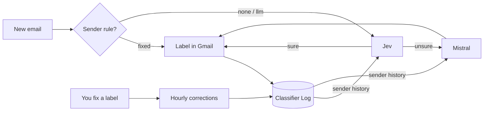

# gmail-triage

A Gmail triage system on n8n that learns from your corrections. Every incoming email gets exactly one label: To respond, Meeting update, Comment, Notification, FYI, Actioned, Newsletter, Marketing or Digest. You fix mistakes the way you normally would, by changing the label in Gmail, and the next emails from that sender are judged with your fix in mind.

It only applies labels and marks some emails as read. It never replies, drafts, archives or deletes anything.

## What's inside

- **Two models in a row.** Jev (TypeSafe) classifies with a confidence score. Below 0.6, Mistral decides.
- **Doubts are flagged.** When Jev was unsure and Mistral picked another label, the email gets **🤖 To Check** and stays unread.
- **Corrections are tracked.** Every hour, each logged decision is compared with the labels now on the email: `corrected`, `removed` or `confirmed`.
- **Past corrections come back as context** for that sender's next emails. They are not turned into a hard rule, so mixed senders are still judged email by email.
- **Sender rules.** A fixed label per address or domain, with no model call, or `llm` to always judge with the models.
- **🤖 Force AI.** Put it on any email of a mixed sender, and that sender is always judged email by email.
- **Portable.** Gmail labels, Data Tables and credentials are found by name, so the workflow files contain no account id.



## Docs

- [Setup](docs/setup.md): Gmail labels, credentials, then import the workflows or deploy from the command line.
- [Architecture](docs/architecture.md): both workflows step by step, the Data Tables, the code.
- [The learning loop](docs/learning-loop.md): corrections, doubts, sender rules, Force AI, and how to measure it.

## Repository

```
n8n/build.py              generates the workflows (label definitions, prompts, thresholds)
n8n/workflows/            ready-to-import workflows, built from n8n/config.example.json
n8n/n8n.py                deploy and inspect through the n8n public API
n8n/datatables.json       Data Table schema
tools/guard.py            pre-commit check against secrets and account identifiers
```

Enable the guard once per clone: `git config core.hooksPath .githooks`.

## License

MIT, see [LICENSE](LICENSE).
