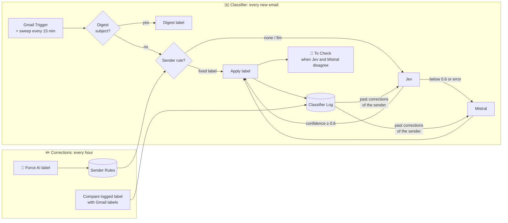

# Architecture

Two n8n workflows and two Data Tables. Both workflows are generated by `n8n/build.py`, so the JSON in `n8n/workflows/` is never edited by hand.

## Classifier

Entry points:

- **Gmail Trigger**, polling every minute.
- **Sweep**, every 15 minutes. It feeds back emails from the last 2 hours that still have no triage label and are more than 5 minutes old. The trigger only returns emails dated after its previous poll, so an email Gmail indexes late would otherwise be missed.

Steps for each email:

1. **Digest check.** An email whose subject is in `digestSubjects` gets the Digest label and nothing else. Leave the list empty to turn this off.
2. **Already labelled?** An email that already carries a triage label is skipped. This makes reruns, trigger restarts and trigger/sweep overlaps harmless.
3. **Prepare.** Builds the sender, recipients, subject, date and whether a `List-Unsubscribe` header is present. The body is taken from the text part, or from the HTML without its tags, cut at 6,000 characters.
4. **Sender rules.** The exact address beats the domain (`@example.com`), and a `manual` rule beats the others.
   - A `fixed` rule labels the email directly.
   - An `llm` rule, or no rule, sends it on to the models.
5. **Jev** ([TypeSafe](https://typesafe.ai), pinned model version) picks one label among the definitions in `CATEGORIES` and gives a confidence. The sender's past corrections are passed along when there are any.
6. **Mistral** decides when Jev is below 0.6 or fails. It gets the same definitions and history, and its output is restricted to the label list.
7. **Label.** The label is applied in Gmail. Meeting update, Newsletter and Marketing are also marked as read, unless they are a doubt.
8. **Doubt.** Jev was below the threshold and Mistral chose a different label, so the email also gets **🤖 To Check** and stays unread.
9. **Log.** The decision is written to `Classifier Log`: label, source (`rule`, `jev` or `mistral`), Jev's choice and confidence, the doubt flag, and status `open`.

Gmail label ids are never stored. A `Gmail labels` node reads them by name at the start of each run, and the run stops with a clear error if one is missing.

## Corrections

Every hour:

- It reads the `open` rows of `Classifier Log` and the emails from the last 8 days in one Gmail search, then sets a status on each row (see [the learning loop](learning-loop.md)).
- It turns the senders of emails labelled **🤖 Force AI** into `llm` rules, then removes the label.

## Data Tables

Schema in `n8n/datatables.json`, created with `n8n.py ensure`.

| Table | Columns |
| --- | --- |
| Classifier Log | messageId, from, subject, category, confidence, jevChoice, source, model, status, finalCategory, doubt |
| Sender Rules | pattern (address or `@domain`), mode (`fixed` or `llm`), category, origin, hits, note |

## Code

| File | Role |
| --- | --- |
| `n8n/build.py` | Generates both workflows from a config: label definitions, thresholds, prompts and graph. |
| `n8n/config.example.json` | Label names, table names, doubt and Force AI labels. Copy it to `config.local.json` and add your credentials. |
| `n8n/workflows/` | The workflows built from the example config, ready to import. |
| `n8n/n8n.py` | Deploys and inspects through the n8n public API: workflows, executions and Data Tables. Credentials are matched by name, and a redeploy keeps the ones chosen in the UI. |
| `tools/guard.py` | Pre-commit check against secrets and account identifiers. |
